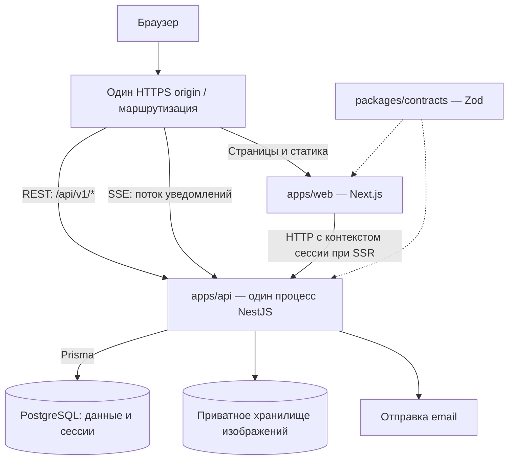

# Instagram Clone — Architecture Overview

**Статус:** техническая основа утверждена; продуктовые вопросы остаются открытыми.
**Основание:** [PRD v0.5](../product/PRD.md), Architecture Proposal и Architecture Decision Review.

PRD определяет продуктовое поведение. Этот документ фиксирует технические границы и ограничения MVP для команды из двух разработчиков. Утверждение технической основы не означает финального утверждения PRD, который сохраняет статус Draft. Нерешённые правила перечислены в [разделе 17](#17-open-product-decisions).

## 1. System Overview

Система строится как Modular Monolith: один NestJS backend с предметными модулями, одна PostgreSQL и отдельный Next.js frontend. Модули API взаимодействуют внутри процесса. Браузер обращается к REST API и получает realtime-уведомления через SSE.

PostgreSQL хранит прикладные данные и сессии. Изображения хранятся приватно и выдаются после серверной проверки доступа. Для MVP работает один экземпляр API; Redis, Kafka и микросервисы не используются.

**Текущее состояние:** реализованы web shell, proxy и browser smoke, NestJS readiness/Swagger с реальной PostgreSQL 18.6 / Prisma 7.10.1 и CI. FND-02 readiness/error контракт принят Developer 2. Первый срез этапа 2 добавляет [Auth-модели и миграцию](../development/auth-database.md): пользователей, сессии и одноразовые токены. [Backend Auth API](../development/auth-api.md) реализует регистрацию неподтверждённого аккаунта, вход, cookie-сессию и logout со Swagger. Verification/recovery, SMTP, frontend-формы, приватность, media и Direct ещё не реализованы. FND-08 остаётся открытым; владелец разрешил облачную разработку этапа 2 до проверки двух реальных ПК. Далее описывается утверждённая архитектура к реализации, если явно не указано иное.

## 2. Architecture Diagram

Диаграмма показывает целевую архитектуру MVP, а не уже развёрнутую систему.



## 3. Technology Stack

| Область           | Сейчас в репозитории                                               | Утверждено к реализации                                  |
| ----------------- | ------------------------------------------------------------------ | -------------------------------------------------------- |
| Среда и Monorepo  | Node.js 24.19.0 в `.nvmrc`, pnpm 12.14.0, Turborepo                | Сохраняются; допустимый Node указан в корневом `engines` |
| Frontend          | Next.js 16.4.2, React 19.3.0, Tailwind CSS, конфигурация shadcn/ui | Сохраняются                                              |
| Backend           | NestJS 12.2.0 с Express, RxJS                                      | Предметные модули внутри одного API                      |
| TypeScript        | Web 5.9.3, API 6.0.3                                               | Общий пакет проверяется обоими приложениями              |
| Данные            | PostgreSQL 18.6 / Prisma 7.10.1: конфигурация и отдельные проверки БД | Подключение к NestJS и прикладная схема                   |
| Контракты         | `packages/contracts`: Zod readiness/error, fixtures, импорты API/web | Совместное review и расширение по прикладным срезам       |
| Сессии и realtime | Не реализованы                                                     | Cookie-сессии в PostgreSQL; REST + SSE                   |
| Тестирование      | Vitest и Supertest в API                                           | Интеграционные и браузерные проверки сценариев PRD       |

Источники версий и команд: [корневой package.json](../../package.json), [web/package.json](../../apps/web/package.json), [api/package.json](../../apps/api/package.json), [lockfile](../../pnpm-lock.yaml) и [Compose](../../compose.yaml). PostgreSQL/Prisma закреплены для Database Foundation; конкретные провайдеры storage/email ещё не выбраны.

## 4. Monorepo Structure

Существуют `apps/web`, `apps/api`, `packages/contracts` и документация в `docs/`. Workspace включает `apps/*` и `packages/*`; зависимости управляются единым корневым lockfile.

Предметный код размещается по мере реализации:

```text
apps/web/
  app/                         # маршруты и layouts
  features/<feature>/          # UI и клиентские сценарии
  components/ui/               # компоненты shadcn по мере добавления
  lib/api/                     # REST-клиент
  lib/realtime/                # SSE и синхронизация
apps/api/
  src/modules/<module>/        # предметные модули
  src/infrastructure/          # database и внешние адаптеры
  test/                        # интеграционные и API e2e-тесты
packages/contracts/            # FND-02 readiness/error, развитие по срезам
docs/product/PRD.md
docs/architecture/overview.md
```

Это соглашение о размещении, а не перечень уже созданных каталогов. Схема Prisma и история миграций принадлежат `apps/api`; точное расположение зависит от выбранной версии Prisma. Web не импортирует серверный код или Prisma-модели. Между приложениями передаются только публичные контракты через workspace-пакет.

## 5. Frontend Responsibilities

Web отвечает за маршрутизацию, адаптивный UI, формы, предварительную проверку ввода и состояния из PRD, включая reconnecting. REST-клиент и SSE-обработчик согласованно обновляют списки и историю сообщений, объединяя записи по серверным идентификаторам.

Все прикладные операции выполняются через API, включая запросы из Server Components. При SSR передаётся контекст текущей сессии; отдельная система авторизации в Next.js не создаётся. Скрытие элементов интерфейса не заменяет серверную проверку.

Персональные ответы не попадают в общий серверный кеш. Клиентский кеш очищается при выходе и смене пользователя. В существующем Next.js включены Cache Components: их использование не должно кешировать защищённые данные для другого пользователя. Библиотека клиентского управления данными отдельно не утверждена.

## 6. Backend Module Boundaries

Все перечисленные прикладные модули пока планируются. Категории описывают ответственность, а не график разработки.

| Категория   | Модуль              | Граница ответственности                                                      |
| ----------- | ------------------- | ---------------------------------------------------------------------------- |
| Базовые     | `DatabaseModule`    | Prisma, соединения и инфраструктура транзакций                               |
| Базовые     | `AuthModule`        | Регистрация, пароли, сессии, email verification и recovery                   |
| Базовые     | `UsersModule`       | Профили, username, настройки приватности и поиск                             |
| Базовые     | `MailModule`        | Отправка писем и её локальный механизм повторов                              |
| Функции MVP | `SocialGraphModule` | Подписки, запросы и удаление подписчика; блокировки после определения правил |
| Функции MVP | `PostsModule`       | Публикации, лайки, комментарии, выборка ленты и политика доступа к постам    |
| Функции MVP | `MediaModule`       | Обработка, хранение, защищённая выдача и очистка файлов                      |
| Функции MVP | `DirectModule`      | Диалоги, история, отправка сообщений и SSE                                   |
| v0.4        | `MediaModule`, `PostsModule` | Видео: проверка и перекодирование (ffprobe/ffmpeg), выдача по Range, лента Reels (этап 8) |
| v0.4        | `CallsModule` (предложено) | Звонки WebRTC 1:1: состояния и авторизованная сигнализация; правила как у Direct (этап 9) |
| v0.5        | `LivesModule` | Эфиры (этап 10): состояние эфира и чат в PostgreSQL, зрители и SDP/ICE в памяти процесса; видео идёт WebRTC от браузера ведущего без медиасервера; право просмотра — политика постов |

Controller принимает запрос, service выполняет сценарий, работа с Prisma остаётся внутри серверного модуля. Изменение принадлежащих модулю данных выполняется через его методы. Общие транзакции имеют явного владельца сценария и используют один transaction context.

Отдельные `AccessModule` и `JobsModule` первоначально не обязательны. Политика постов экспортируется из `PostsModule` и переиспользуется при выдаче media; правила диалогов принадлежат `DirectModule`. Условия доступа не копируются по controllers. Зависимости должны оставаться без циклов: файловый адаптер не зависит от логики постов.

Повторы писем принадлежат `MailModule`, очистка media — `MediaModule`. Нужные устойчивые задания хранятся в PostgreSQL и обрабатываются внутри API. Общий `JobsModule` выделяется при фактическом повторении механизмов. `FeedModule` и самостоятельный `HealthModule` также не требуются до появления отдельной ответственности.

## 7. Database and Prisma Strategy

PostgreSQL — источник прикладных данных. Prisma используется только API. Его конкретная версия, клиент и команды миграций фиксируются совместно; документация и код не смешивают API разных поколений Prisma.

- Модель данных охватывает пользователей, сессии, одноразовые токены, отношения подписки, посты, media, лайки, комментарии, личные диалоги и сообщения.
- Внутренние связи используют неизменяемый ID пользователя, поскольку username изменяем.
- Уникальность email/username, пары подписки, пары участников личного диалога и лайка обеспечивается БД. Точные правила нормализации задаются перед реализацией контрактов.
- Проверки прав и изменения, подверженные гонкам, согласуются транзакционно. Принятие запроса подписки — условный переход из ожидающего состояния. Конфликты обрабатываются с ограниченными безопасными повторами.
- Отправка Direct атомарно сохраняет сообщение и обновляет активность диалога; уникальный ключ отправителя и `clientMessageId` защищает от повторов.
- Лента использует SQL-фильтрацию видимости до пагинации и стабильный порядок `(createdAt DESC, id DESC)`. История Direct имеет стабильный серверный порядок и курсор.

Миграции хранятся в Git, проходят review и проверяются на настоящей PostgreSQL. Они применяются контролируемо при выпуске, а не независимо каждым процессом. Первая Auth-схема и миграция описаны в [Auth database](../development/auth-database.md); модель Prisma не заменяет публичные контракты API.

## 8. Authentication and Session Architecture

Случайный непрозрачный токен сессии передаётся в cookie; PostgreSQL хранит его хеш, пользователя и срок действия. Production-cookie имеет `HttpOnly`, `Secure`, `SameSite=Lax`, host-only область и путь, охватывающий API. Внешний origin приложения и API общий.

На защищённых запросах API проверяет сессию и подтверждение email. До подтверждения доступны только операции auth, verification и recovery, разрешённые PRD. Logout отзывает соответствующую сессию, очищает cookie и закрывает её SSE-потоки.

Пароли хешируются Node.js crypto.scrypt (N=32768, r=8, p=3, 16-byte salt, 64-byte key); сессия живёт 7 суток. [Auth API](../development/auth-api.md) описывает format v1, ограничение работы, Origin/CSRF и cookie-конфигурацию. Сроки verification/recovery-токенов ещё нужно зафиксировать перед их реализацией. Подтверждение email и recovery используют разные одноразовые токены с ограниченным сроком и хешами в БД. Погашение токена атомарно; смена пароля инвалидирует применимые recovery-токены. Ответ восстановления не раскрывает существование email.

Письма передаются через заменяемый адаптер; сбой отправки не должен требовать повторной регистрации. Задания содержат минимальные необходимые данные, не раскрывают токены в логах и безопасно переживают повтор. После успешного восстановления пароля отзываются все сессии аккаунта, включая текущую. В первом auth-срезе требуется новый вход. Будущий автовход требует отдельной выдачи новой сессии API после отзыва старых; frontend не создаёт сессии самостоятельно. Локально используется Mailpit; целевая размещённая демоверсия доставляет письма пользователю через SMTP, провайдер и delivery-проверка ещё не выбраны.

## 9. Authorization and Privacy

Для подтверждённого пользователя пост доступен, если он его автор, профиль автора публичный либо подписка одобрена. В ленту включаются только собственные посты и посты подписок согласно FR-05. Ожидающий запрос не даёт доступа. Правила блокировок и гостевого просмотра ещё не определены.

Одна политика видимости применяется к посту, сетке профиля, ленте, связанным комментариям/лайкам и файлам. Каждая новая выдача проверяет актуальные права, включая прямые запросы по ID и последующие страницы. После отписки или удаления подписчика приватный контент больше не возвращается.

Сводка приватного профиля содержит разрешённые FR-02 поля и счётчики без скрытых постов. Видимость списков подписчиков/подписок решается отдельно. Права удаления комментариев соответствуют FR-06: автор комментария и автор поста имеют предусмотренные PRD полномочия.

Проверка в UI не является защитой. API формирует явные response projections, не сериализует внутренние записи целиком. Защищённые ответы используют `Cache-Control: private, no-store`.

## 10. Media Storage and Delivery

Все файлы хранятся приватно, включая изображения аккаунтов, которые сейчас публичны. Конкретный провайдер и адаптер хранилища не выбраны. Постоянные публичные object URL не выдаются. API проверяет права на ресурс при каждом запросе файла и передаёт разрешённый вариант изображения.

Сервер проверяет фактический формат, размер файла, число пикселей и возможность декодирования, ограничивает параллельную обработку, удаляет метаданные и создаёт ограниченный набор размеров. Значения JPEG/PNG/WebP и 10 МБ в PRD остаются предложенными ограничениями, а не окончательно утверждёнными лимитами.

У незавершённой загрузки есть контролируемое состояние: ошибка не создаёт видимый некорректный пост. БД и storage не имеют общей транзакции; оставшиеся файлы удаляются повторяемой очисткой. Удаление поста сразу прекращает новую выдачу, независимо от завершения физического удаления.

Права на аватар следуют правилам сводки профиля, а не автоматически правилам приватного поста. Защищённые изображения не проходят через общий кеш Next Image Optimizer; используются подготовленные размеры с `unoptimized` либо обычный `img`. Подписанные GET-ссылки не являются выбранным механизмом выдачи приватного контента.

## 11. REST and SSE Communication

REST `/api/v1` обслуживает изменения и чтение истории. SSE уведомляет клиента об изменениях Direct, звонков и эфиров (события `message`, `call`, `live` в одном потоке вкладки); текст сообщения и история доступны через авторизованный REST API. PostgreSQL остаётся источником истины, SSE не считается устойчивым хранилищем событий.

Отправка сообщения включает проверку сессии, участника диалога и лимитов, транзакционное сохранение и затем уведомление. Успех означает сохранение сервером, а не прочтение получателем. Повтор использует прежний `clientMessageId` и возвращает прежний результат; иной payload с тем же ключом отклоняется.

SSE-подключение авторизуется cookie-сессией и подтверждённым email до открытия потока. Получатель определяется сервером; токены не передаются в URL. Поток ограничен сроком сессии и закрывается при её отзыве. Один поток на вкладку объединяет уведомления диалогов; медленные и отключившиеся клиенты не удерживают неограниченные буферы или ресурсы.

При подключении клиент сначала устанавливает подписку и получает сигнал её готовности, затем синхронизирует данные по REST. Поступившие события и история объединяются по ID. Такой порядок закрывает промежуток между загрузкой истории и подпиской. Reconnect, возвращение во вкладку и периодическая сверка активного диалога запускают повторную синхронизацию. Потерянное уведомление не означает потерю сохранённого сообщения.

## 12. Shared API Contracts

`packages/contracts` содержит browser-safe Zod-схемы readiness/error и валидируемые fixtures; TypeScript-типы выводятся из них. [Контракт FND-02 и передача Developer 2](../development/foundation-contracts.md) требуют совместного review до зависимой реализации. Схемы запросов, остальных ответов и SSE-событий добавляются по мере согласования срезов. API проверяет входные данные во время выполнения, web использует те же ограничения для форм. Контракт проверяет формат, но не заменяет авторизацию или ограничения БД.

Контракты включают безопасные поля ответа, ошибки с машинным `code`, ограниченную пагинацию, курсоры и сериализуемые даты. Prisma-модели, NestJS-сервисы, секреты и внутренние поля пользователя не экспортируются. Изменение API сопровождается изменением схем и тестов, а не независимым копированием типов в web.

## 13. Testing Strategy

Сейчас есть стартовые unit/API e2e-тесты на Vitest и Supertest, unit-проверки безопасной dev/test конфигурации и отдельные integration checks Database Foundation на PostgreSQL. Web имеет Vitest/Testing Library и Playwright harness; браузерный readiness smoke обращается к настоящему API через web proxy. Прикладное покрытие добавляется по срезам.

| Уровень                  | Проверяемая гарантия                                                                    |
| ------------------------ | --------------------------------------------------------------------------------------- |
| Unit                     | Политики доступа, переходы статусов, проверка данных                                    |
| Integration с PostgreSQL | Миграции, ограничения, гонки подписок, одноразовые токены, атомарность Direct           |
| API e2e                  | Сессии, CSRF, обязательный verified email, защита постов, файлов и диалогов             |
| REST + SSE               | Переподключение, разрыв между сохранением и уведомлением, повтор отправки, отзыв сессии |
| Browser e2e              | Критические пользовательские сценарии PRD в независимых контекстах браузера             |
| Контракты                | Соответствие ответов схемам и отсутствие внутренних полей                               |

Обязательны отрицательные проверки: прямой URL приватного файла, чужой диалог, повторное чтение после потери подписки, смена пользователя без утечки кеша. Интеграционные тесты используют PostgreSQL, а не SQLite. Браузерные проверки используют Playwright согласно [FND-01 baseline](../development/foundation-baseline.md).

Корневые `check-types`, `lint`, `build`, `test` и `test:e2e` уже существуют. Наличие команд не означает, что будущие функции покрыты тестами; у web есть явные scripts Vitest и Playwright, а readiness smoke использует настоящий API/БД через общий origin web. Автоматизация определена в [Foundation CI](../development/ci.md); успешный GitHub run и совместная приёмка проверяются отдельно.

## 14. Deployment Constraints

- Один постоянно работающий процесс API, без cluster mode и нескольких реплик; web запускается отдельно. Короткое прерывание при выпуске допустимо, клиент восстанавливает соединение и историю.
- Общий HTTPS origin маршрутизирует страницы в Next.js, API и SSE — непосредственно в NestJS. Для SSE отключены буферизация/кеширование, настроены heartbeat и idle timeouts. HTTP/2 предпочтителен для нескольких вкладок.
- PostgreSQL и media имеют постоянное хранилище. Нужны резервное копирование и проверка восстановления. Уведомления и соединения могут быть в памяти, сообщения и сессии — нет.
- Секреты передаются серверному окружению; web не получает DB/storage credentials. Прикладная конфигурация проверяется при старте. Health/readiness проверяют необходимые зависимости.
- Локально нужны PostgreSQL, тестовая почта и приватный storage-адаптер; PostgreSQL и Mailpit настроены в Compose; [локальный запуск](../development/local-environment.md). Приватный storage-адаптер относится к этапу media. Файлы локального адаптера не размещаются в публичных каталогах web/API.

Хостинг должен поддерживать долгие потоковые ответы. Общая БД сама не доставляет SSE-события между процессами. Несколько экземпляров потребуют отдельного пересмотра доставки, который не входит в MVP.

## 15. Security Considerations

- Auth и авторизация выполняются на сервере; доступ запрещается при отсутствии требуемого разрешения. Открытые продуктовые правила нельзя подменять неявными разрешениями.
- Изменяющие cookie-auth запросы защищаются от CSRF; проверяется допустимый Origin. SSE не выполняет изменений, его origin и доступ также контролируются.
- Входные данные проверяются Zod, записи защищаются ограничениями и транзакциями БД. SQL параметризуется; клиент не управляет произвольными фильтрами или object keys.
- Чувствительные endpoints, новые диалоги, сообщения и uploads имеют лимиты; открытая регистрация не отменяет защиту от спама. Конкретные значения определяются до включения функций.
- Текст пользователя отображается безопасно; секреты, сессии, одноразовые ссылки и содержимое Direct не попадают в логи. Логи используют безопасные идентификаторы и `requestId`.
- Внешние адаптеры получают минимальные права. Текущая шаблонная конфигурация Nest Observe не означает готовность мониторинга production.

## 16. Known Limitations

- Один API — единая точка отказа и ограничение ёмкости соединений. Высокая доступность и горизонтальное масштабирование не заявлены.
- SSE-уведомление может потеряться; доставка данных восстанавливается из БД. Не заявляются exactly-once доставка транспорта или непрерывное соединение.
- Выдача изображений через API увеличивает его трафик. Уже скачанные файлы и скриншоты невозможно отозвать; запрет применяется к новым проверкам доступа.
- Идентичность БД и storage восстанавливается очисткой и повторами, а не общей транзакцией.
- Direct не имеет E2EE согласно PRD. Подтверждение записи сервером не является индикатором прочтения.
- Техническая основа утверждена, но большинство прикладных компонентов ещё не реализовано. Публичный production-запуск не подтверждается этим документом.

## 17. Open Product Decisions

Применяется [раздел 7 PRD](../product/PRD.md#7-remaining-open-decisions). Следующие вопросы остаются нерешёнными; документ не задаёт ответ по умолчанию.

| Вопрос                                                                    | Статус и влияние                                                                                                                                                                              |
| ------------------------------------------------------------------------- | --------------------------------------------------------------------------------------------------------------------------------------------------------------------------------------------- |
| Видимость списков подписчиков/подписок приватного профиля                 | Открыт; определяет права чтения и контракты списков                                                                                                                                           |
| Блокировки, сообщения от незнакомых и возможность их отключить            | Открыт; нужны правила новых сообщений, прежней истории и влияния на остальные функции. Утверждённое FR-09 разрешение начать диалог независимо от подписки сохраняется до явного изменения PRD |
| Существующие подписчики и ожидающие запросы при смене приватности         | Открыт; блокирует окончательные переходы состояний                                                                                                                                            |
| Политика media и лимиты uploads                                           | Приватное хранение и серверный контроль доступа утверждены технически. Провайдер, точные лимиты/форматы и оставшиеся продуктовые детали не утверждены                                         |
| Демонстрация verification/recovery | Решено владельцем 2026-10-22: Mailpit локально, SMTP на почту пользователя в размещённой демоверсии; провайдер и проверка доставки ещё предстоят |
| Закрытое тестирование или открытая регистрация | Решено владельцем 2026-10-22: открытая регистрация; публичный допуск и защита от злоупотреблений принимаются на этапе 12 (roadmap v0.5) |
| Анонимный просмотр публичных профилей                                     | Не определён явно; ограничения неподтверждённых пользователей из FR-01 сохраняются                                                                                                            |
| Отзыв остальных сессий после password recovery | Решено владельцем 2026-10-22: отозвать все сессии, включая текущую; будущий автовход отдельным срезом |
| Удаление своего комментария после потери доступа к посту                  | Дополнительное уточнение пересечения правил FR-06 и приватности                                                                                                                               |
| Длины username/bio/caption/комментариев/сообщений и частоты запросов | Auth-поля и поведение при ограничении согласованы в FR-01; технические rate limits определяются при реализации. Остальные поля остаются открытыми |
| Дизайн, тексты ошибок, индикаторы прочтения/набора, настройки уведомлений | PRD допускает последующую детализацию; индикаторы не считаются обязательной частью текущего Direct                                                                                            |
| Удаление аккаунта и хранение данных                                       | Открыт; нужны отдельные правила удаления и retention                                                                                                                                          |

Несоответствие статусов документов процедурное: PRD всё ещё требует решений перед финальным утверждением архитектуры. Здесь утверждена техническая основа по решению команды, а связанные продуктовые правила остаются открытыми. Противоречий между этой технической основой и утверждёнными правилами FR-01–FR-09 не обнаружено.
